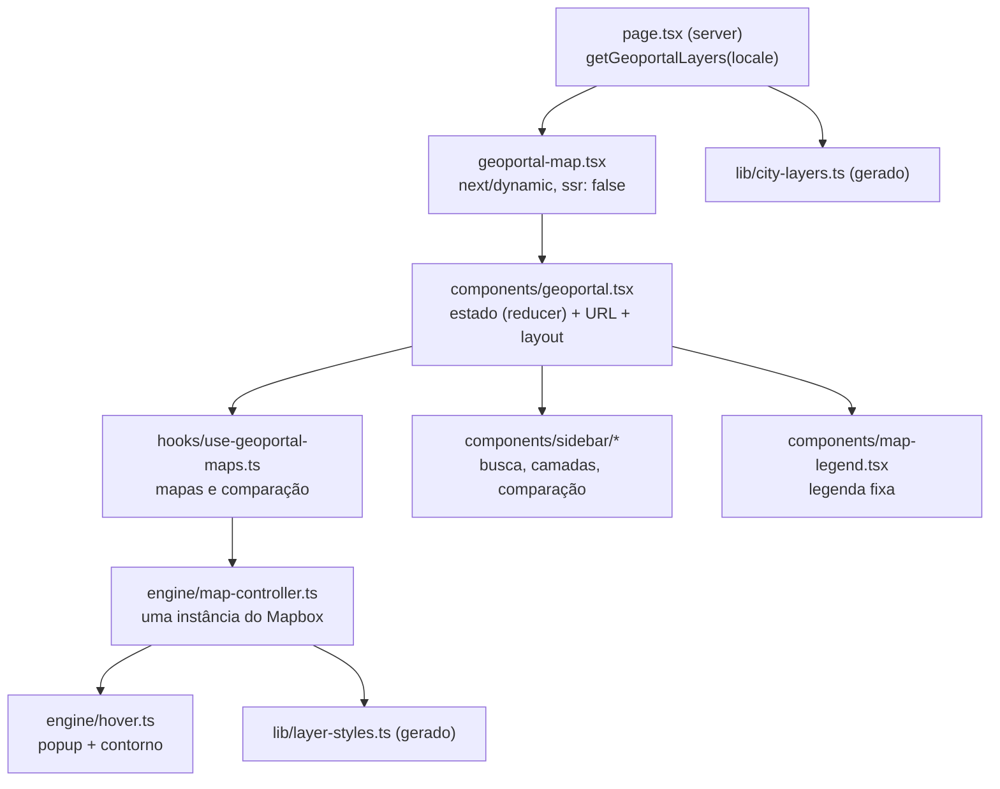

# Geoportal — Documentação Técnica

Mapa interativo baseado em **Mapbox GL JS** que permite visualizar camadas de dados geoespaciais por cidade, com suporte a modo de comparação, estado compartilhável via URL e navegação integrada ao Catálogo de Dados.

---

## Funcionalidades

| Funcionalidade | Descrição |
|---|---|
| **Escolha da cidade** | Modal na entrada (pulado por links com `?city=`) e dropdown no canto superior esquerdo do mapa |
| **Camadas por tema** | Sidebar com as camadas agrupadas pelo tema do catálogo; opacidade, "Acessar dado" e "Acessar história" |
| **Ordem das camadas** | Lista das camadas ligadas, reordenável por arrasto (mouse, toque e teclado, com `@dnd-kit`) |
| **Busca de endereço** | Mapbox Geocoding v6, restrita ao município escolhido |
| **Comparação** | Duas camadas, em barra deslizante ou lado a lado |
| **Compartilhar** | Web Share API do navegador; sem ela, copia o link |
| **Mapa base** | Claro (padrão), escuro e satélite |
| **Visão 3D** | Relevo (Mapbox Terrain-DEM) e inclinação |
| **Controles** | Zoom, alinhar ao norte, redefinir visualização, escala, modo apresentação |
| **Estado na URL** | Toda a visualização é serializável e compartilhável |
| **Hover popup e legenda** | Atributos do polígono de cima; legenda fixa gerada dos estilos |

Custos: tudo roda dentro do map load do GL JS (tiles, estilos e relevo
incluídos), exceto a busca de endereço, que usa o geocoding temporário
(gratuito até 100 mil requisições/mês). A busca não guarda resultados (os termos
proíbem) e contém o consumo com debounce, mínimo de 3 caracteres e cancelamento.

---

## Arquitetura



- **Estado:** `lib/geoportal-state.ts` é um reducer puro (cidade, camadas na
  ordem de desenho, opacidades, mapa base, relevo, comparação). O mapa é
  derivado dele.
- **Motor:** `GeoMapController` recebe o que deve estar no mapa e aplica a
  diferença. É o único caminho que adiciona ou remove fontes e camadas. Ao
  trocar o mapa base (`setStyle`), recoloca camadas, relevo e listeners no
  `style.load`. Também observa o tamanho do contêiner (o GL JS 3.16 só escuta a
  janela).
- **Dados enriquecidos:** `lib/geoportal-layers.ts` roda no servidor e junta a
  cada camada o tema do catálogo (pelo `catalogItemId`) e a história que usa o
  dado. O cliente não recebe o catálogo.
- **Cidades:** `lib/cities.ts` guarda centro, zoom, bbox e Wikidata de cada
  cidade. Um teste garante que toda cidade de `city-layers.ts` esteja lá.
- **Testes:** `tests/mapas-geoportal.test.mjs` cobre URL, reducer, ordem,
  grupos, geocoding e escala. Os módulos de `lib/` não têm imports em runtime
  para poderem ser carregados pelo teste.

---

## Estado serializado na URL

Toda a visualização é capturada em query params. Ao copiar e colar a URL, o
mapa restaura exatamente o mesmo estado. A escrita usa
`window.history.replaceState` com debounce (integrado ao App Router, sem buscar
a página de novo).

### Modo normal

```
/mapas?city=Rio+de+Janeiro
  &layers=ic_areas-3ii8xj,quali_area-1ci0wo
  &opacity=ic_areas-3ii8xj:50
  &theme=dark
  &terrain=1
  &zoom=12.2900&bearing=17.60&pitch=34.50
  &lat=-22.84302&lng=-43.26905
```

### Modo comparação

```
/mapas?city=Rio+de+Janeiro
  &compare=1&layer1=ic_areas-3ii8xj&layer2=quali_area-1ci0wo
  &view=split
  &zoom=12.2900&bearing=17.60&pitch=34.50&lat=-22.84302&lng=-43.26905
```

### Parâmetros disponíveis

| Param | Tipo | Padrão | Descrição |
|---|---|---|---|
| `city` | string | — | Cidade (`São Paulo`, `Rio de Janeiro`). Sem ela, abre o seletor |
| `layers` | CSV | — | Camadas ativas, de baixo para cima (modo normal) |
| `opacity` | CSV de `id:val` | `80` | Opacidade por camada (0–100); a padrão não é escrita |
| `theme` | `light` \| `dark` \| `satellite` | `light` | Mapa base |
| `terrain` | `1` | — | Relevo 3D ligado |
| `zoom`, `bearing`, `pitch`, `lat`, `lng` | float | enquadramento da cidade | Câmera |
| `compare` | `1` | — | Modo comparação |
| `layer1`, `layer2` | string | — | Camada da esquerda e da direita (de cima e de baixo, no celular) |
| `view` | `split` | deslizante | Comparação lado a lado |

Valores inválidos são descartados na leitura: cidade desconhecida, camadas de
outra cidade, números que não são números, ângulos e zoom fora do intervalo.
Links antigos (`theme=light`, `compare=1&layer1=…`) continuam válidos.

---

## Camadas disponíveis

As camadas vêm do registro `portal/geoportal/data/geoportal_layers.csv`, no repositório [portalcidados-data](https://github.com/inspercidades/portalcidados-data).

### Rio de Janeiro

| ID | Nome | Catálogo |
|---|---|---|
| `ic_areas-3ii8xj` | Ilhas de calor | [Item 8](/catalogo-de-dados?item=8) |
| `ic_pontos-90vwh4` | Ilhas de calor (pontos de medição) | [Item 8](/catalogo-de-dados?item=8) |
| `quali_area-1ci0wo` | Qualidade do ar | [Item 8](/catalogo-de-dados?item=8) |
| `quali_pontos-b424eh` | Qualidade do ar (pontos de medição) | [Item 8](/catalogo-de-dados?item=8) |

### São Paulo

| ID | Nome | Catálogo |
|---|---|---|
| `faixa-azul-trechos-spo` | Faixa Azul | [Item 15](/catalogo-de-dados?item=15) |
| `sinistros-por-distrito-spo` | Sinistros por distrito | [Item 14](/catalogo-de-dados?item=14) |
| `sinistros-por-trecho-spo` | Sinistros por trecho de via | [Item 14](/catalogo-de-dados?item=14) |
| `densidade-hab-setor` | Densidade habitacional (setor censitário) | [Item 2](/catalogo-de-dados?item=2) |
| `densidade-hab-distrito-spo` | Densidade habitacional (distrito) | [Item 2](/catalogo-de-dados?item=2) |
| `densidade-pop-setor-spo` | Densidade populacional (setor censitário) | [Item 2](/catalogo-de-dados?item=2) |
| `densidade-pop-distrito-spo` | Densidade populacional (distrito) | [Item 2](/catalogo-de-dados?item=2) |
| `verticalizacao-setor` | Verticalização (setor censitário) | [Item 2](/catalogo-de-dados?item=2) |
| `verticalizacao-distrito-spo` | Verticalização (distrito) | [Item 2](/catalogo-de-dados?item=2) |
| `raster-dbiubd` | Verticalização (grade) | [Item 2](/catalogo-de-dados?item=2) |
| `geoses-spo` | GeoSES | [Item 16](/catalogo-de-dados?item=16) |
| `mortalidade_materna_fem` | Mortalidade materna (fem.) | [Item 9](/catalogo-de-dados?item=9) |
| `isquemicas_coracao_masc` | Doenças isquêmicas do coração (masc.) | [Item 9](/catalogo-de-dados?item=9) |
| `isquemicas_coracao_fem` | Doenças isquêmicas do coração (fem.) | [Item 9](/catalogo-de-dados?item=9) |
| `cerebrovasculares_masc` | Doenças cerebrovasculares (masc.) | [Item 9](/catalogo-de-dados?item=9) |
| `cerebrovasculares_fem` | Doenças cerebrovasculares (fem.) | [Item 9](/catalogo-de-dados?item=9) |
| `diabetes_masc` | Diabetes mellitus (masc.) | [Item 9](/catalogo-de-dados?item=9) |
| `diabetes_fem` | Diabetes mellitus (fem.) | [Item 9](/catalogo-de-dados?item=9) |

---

## Modo de Comparação

Entrar na comparação cria um segundo mapa (um map load a mais) com a câmera,
o mapa base e o relevo do principal. Sair remove só o segundo: nada se perde
além das camadas, que recomeçam vazias nos dois sentidos.

- **Deslizar:** `mapbox-gl-compare` recorta os dois mapas empilhados e
  sincroniza as câmeras. Vertical no desktop, horizontal no celular.
- **Lado a lado:** cada mapa ocupa metade (no celular, um em cima do outro) e
  `engine/sync-cameras.ts` sincroniza as câmeras.
- Alternar entre os dois não recria mapas.
- Exatamente **1 camada por lado**: a primeira escolhida vai para a esquerda.
- As ações de câmera vão para o mapa principal; a sincronização leva ao outro.

---

## Integração com o Catálogo de Dados

Quando uma camada está selecionada e possui `catalogItemId` definido em `city-layers.ts`, um link **"Acessar dado"** aparece abaixo do slider de opacidade (e **"Acessar história"**, se alguma história publicada usa o dado). O caminho inverso (catálogo → geoportal) está documentado em [`docs/CATALOG_GEOPORTAL_INTEGRATION.md`](../../../../../docs/CATALOG_GEOPORTAL_INTEGRATION.md).

---

## Adicionando uma camada

As camadas, os textos e as cores são gerados no repositório [portalcidados-data](https://github.com/inspercidades/portalcidados-data). Não edite `lib/city-layers.ts` nem `lib/layer-styles.ts` à mão: a próxima geração sobrescreve as mudanças.

1. Lá, adicione uma linha ao registro `portal/geoportal/data/geoportal_layers.csv`, com cidade, nome, textos, tileset, `source-layer`, variável, item do catálogo e enquadramento.
2. Gere o tileset e o estilo com o pipeline em R (`geoportal/R/mapbox.R`). Ele escreve `layer-styles-*.ts`.
3. Rode `portal/geoportal/R/create_city_layers.R`, que escreve `city-layers.ts`.
4. Copie os dois arquivos gerados para `lib/` e abra um PR aqui.

Cada camada de `cityLayersConfig` segue a interface `CityLayer`:

```ts
{
  id: "meu-layer-id",
  name: "Nome na UI",
  summary: "Texto curto do tooltip (i) no painel.",
  description: "Texto da legenda, com unidade, período e fonte.",
  tilesetId: "observatorio-nacional.XXXXXXXX",
  sourceLayer: "nome_do_source_layer", // DEVE bater com a chave em layer-styles.ts
  layerType: "fill",          // fill | line | circle | symbol
  hasCustomStyle: true,       // convenção (não é lido em runtime; ver nota abaixo)
  catalogItemId: "42",        // opcional — ID do item no catálogo
  mapView: {                  // opcional — voo automático ao ativar
    center: [-43.27, -22.84],
    zoom: 12,
    bearing: 0,
    pitch: 0,
  },
}
```

O tooltip mostra `summary` e, na falta dele, `description`.

> O estilo customizado é resolvido pela **chave `sourceLayer`** em
> `lib/layer-styles.ts` (via `createStyledLayer`). O campo `hasCustomStyle`
> **não é consultado** pelo runtime — se o `sourceLayer` não bater com uma
> entrada de `layerStyles`, a camada aparece no estilo azul padrão.

---

## Adicionando uma cidade

1. As camadas da cidade chegam pelo pipeline em `lib/city-layers.ts` (ver acima).
2. Adicione a cidade em `lib/cities.ts`: centro, zoom, bbox do município e
   Wikidata (usado para filtrar a busca de endereço). O teste
   `tests/mapas-geoportal.test.mjs` falha se faltar.

---

## Variáveis de ambiente

```env
NEXT_PUBLIC_MAPBOX_TOKEN=pk.eyJ1...
```

O token precisa dos escopos de estilos, tilesets e geocoding. Convém restringi-lo
por URL no console da Mapbox. O mapa base claro (Mapbox Standard) exige
`'wasm-unsafe-eval'` no `script-src` da CSP (`src/middleware.ts`).

---

## Arquivos do módulo

| Arquivo | Responsabilidade |
|---|---|
| `page.tsx` | Rota `/mapas` (server): metadados e camadas enriquecidas |
| `geoportal-map.tsx` | Fronteira cliente: carrega o geoportal só no navegador |
| `components/geoportal.tsx` | Composição: estado, URL, ações e layout |
| `components/city-picker.tsx` | Modal de escolha e dropdown de cidade |
| `components/menus.tsx` | Menu do site e menu de mapa base |
| `components/map-control.tsx` | Botão e tooltip dos controles do mapa |
| `components/compare-view-toggle.tsx` | Deslizar / Lado a lado |
| `components/map-legend.tsx` | Legenda fixa |
| `components/map-scale.tsx` | Escala do mapa |
| `components/sidebar/*` | Busca de endereço, painel de camadas, comparação, lista reordenável |
| `components/city-layers-context.tsx` | Contexto com as camadas da página |
| `hooks/use-geoportal-maps.ts` | Cria os mapas e liga a comparação |
| `hooks/use-address-search.ts` | Busca com debounce e cancelamento |
| `engine/map-controller.ts` | Camadas, opacidade, ordem, relevo e mapa base numa instância |
| `engine/hover.ts` | Popup e contorno do polígono sob o cursor |
| `engine/sync-cameras.ts` | Sincronia das câmeras no lado a lado |
| `lib/geoportal-state.ts` | Reducer do estado |
| `lib/url-state.ts` | Leitura e escrita da URL |
| `lib/cities.ts`, `lib/base-maps.ts` | Cidades e mapas base |
| `lib/layer-groups.ts`, `lib/layer-order.ts` | Grupos por tema e ordem das camadas |
| `lib/geocoding.ts`, `lib/scale.ts` | Busca de endereço e escala (partes puras) |
| `lib/geoportal-layers.ts` | Tema e história de cada camada (server-only) |
| `lib/city-layers.ts` | **Gerado:** camadas por cidade + lookup catálogo |
| `lib/layer-styles.ts` | **Gerado:** estilos visuais Mapbox (paint/layout) |
| `lib/hover-outline.ts` | Contorno do polígono em hover (partes puras) |
